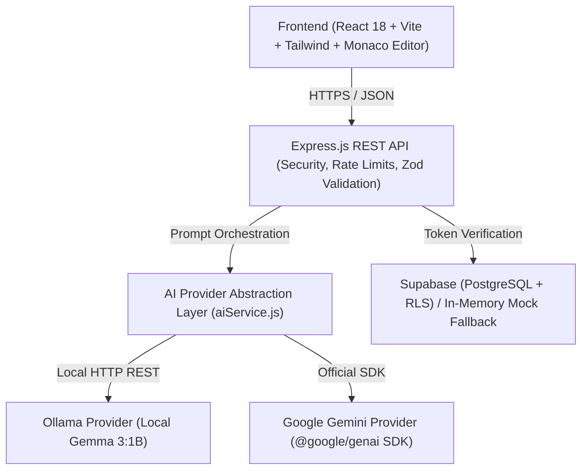

# CodeBuddy AI 🚀

> **Tagline**: *Learn to Code. Understand the Logic. Build Confidence.*  
> Production-ready, pedagogical AI programming tutor designed for undergraduate engineering students mastering **Python**, **C**, **C++**, and **JavaScript**.

---

## 🌟 Overview

Traditional AI assistants often provide copy-paste solutions that bypass the critical struggle of learning to program. **CodeBuddy AI** bridges this gap with an educational-first architecture:
- **Line-by-Line Code Explainer**: Deconstructs every statement in plain English, explaining *why* statements exist and highlighting core programming concepts.
- **Socratic AI Logic Debugger**: Distinguishes certain syntax errors from potential logical or runtime assumptions, providing targeted minimal fixes and prevention tips.
- **5-Tier Socratic Hint Hierarchy**: Unlocks graduated clues without spoiling reference solutions (Conceptual $\rightarrow$ Approach $\rightarrow$ Pseudocode $\rightarrow$ Partial Code $\rightarrow$ Full Solution with confirmation).
- **Interactive Multi-Turn AI Tutor**: Conversational chat interface for Socratic guidance and code discussion.
- **Learning Analytics Dashboard**: Real-time stats, 7-day activity frequencies, streak counters, and curriculum topic tracking.
- **Dual AI Engine**: Supports private, offline local LLMs via **Ollama (Gemma 3:1B)** and cloud intelligence via **Google Gemini (`@google/genai`)**.

---

## 🏗️ Architecture

CodeBuddy AI follows a decoupled 3-tier architecture:



---

## 📂 Project Structure

```text
hacktoberfest/
├── backend/                # Node.js + Express.js API & AI Service
│   ├── src/
│   │   ├── controllers/    # AI, Practice, Dashboard, and Auth controllers
│   │   ├── middleware/     # Security headers, auth, rate limiting
│   │   ├── routes/         # Express REST API endpoints
│   │   ├── services/       # AI Provider abstraction & Supabase client
│   │   └── validators/     # Zod request validation schemas
│   └── tests/              # Backend test suites
├── frontend/               # React 18 + Vite + Tailwind CSS SPA
│   ├── src/
│   │   ├── components/     # Monaco Code Editor, Navbar, ProviderBadge, Footer
│   │   ├── contexts/       # AuthContext, ToastContext
│   │   ├── pages/          # Workspace, Explainer, Debugger, Practice, Chat, Dashboard, History
│   │   └── services/       # Axios API client & Supabase helpers
├── docs/                   # System architecture and REST API specifications
├── supabase/               # PostgreSQL migrations and Row Level Security policies
└── package.json            # Root workspace configuration
```

---

## 🚀 Quick Start

### 1. Prerequisites
- **Node.js**: v18.0.0 or higher
- **npm**: v9.0.0 or higher
- *(Optional)* **Ollama**: If running Gemma 3 locally (`ollama run gemma3:1b`)

### 2. Install Dependencies
```bash
npm install
npm install --prefix backend
npm install --prefix frontend
```

### 3. Start Both Services Concurrently
```bash
npm run dev:all
```
- **Frontend Web UI**: [http://localhost:5173](http://localhost:5173)
- **Backend REST API**: [http://localhost:5000](http://localhost:5000)

---

## 🧪 Testing

Run backend tests:
```bash
npm test
```

---

## 🛡️ Security & Privacy

- **Safe Execution Policy**: Untrusted student code is analyzed via AI; it is never executed via dangerous `eval()` or unconfined subprocesses on the application server.
- **Offline Mode**: Operates 100% offline using in-memory mock data and local Ollama when cloud credentials are not supplied.

---

## 📄 License

MIT License. Crafted with care for Hacktoberfest.

