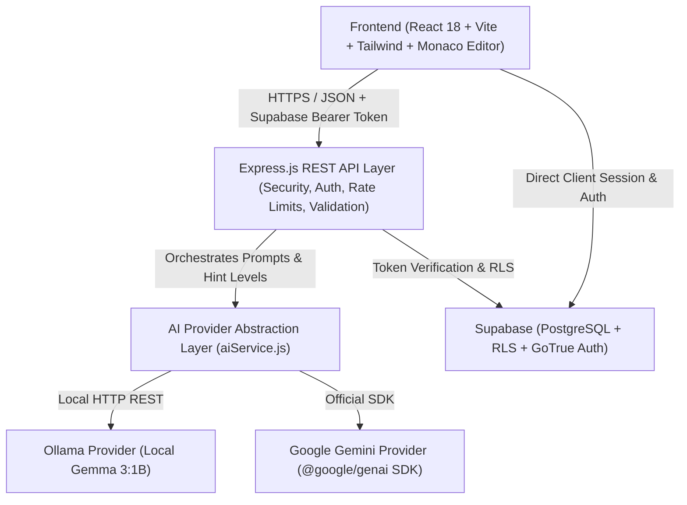

# CodeBuddy AI — System Architecture & Design Specification

> **Tagline**: *Learn to Code. Understand the Logic. Build Confidence.*  
> **Target Audience**: Programming students (BTech CSE / AI & ML) learning Python, C, C++, and JavaScript.

---

## 1. High-Level Architectural Overview

CodeBuddy AI follows a modern, decoupled **Client-Server 3-Tier Architecture** with a dedicated **AI Provider Abstraction Layer** and **Cloud Database & Auth Layer (Supabase)**.

---

## 2. System Components

### 2.1 Frontend Tier (`/frontend`)
- **Framework**: React 18 built with Vite for sub-second HMR and optimized production bundles.
- **Styling**: Tailwind CSS with custom Dark-First Developer Palette (deep navy `#0B0F19`, slate cards `#111827`, electric cyan `#38BDF8`, and vibrant violet `#818CF8`).
- **Code Editor**: Monaco Editor (`@monaco-editor/react`), matching the industry-standard VS Code editing experience with syntax highlighting for Python, C, C++, and JavaScript.
- **Data Visualization**: Recharts for animated, responsive charts tracking problem completion, daily activity streaks, and language proficiency.
- **Routing**: React Router v6 with public, auth-only, and protected layouts.
- **State Management**: React Context (`AuthContext`, `AIProviderContext`, `ToastContext`) and custom hooks for clean separation of UI and network logic.

### 2.2 Backend Tier (`/backend`)
- **Runtime**: Node.js v18+ (tested on v24) with native ECMAScript Modules (`import` / `export`).
- **Web Framework**: Express.js with a modular MVC (Model-View-Controller) structure.
- **Security & Hygiene**:
  - `helmet`: Sets HTTP security headers (CSP, HSTS, X-Content-Type-Options).
  - `cors`: Restricts cross-origin requests to configured frontend origins.
  - `express-rate-limit`: Prevents abuse and quota exhaustion on AI generation endpoints.
  - `zod`: Strict declarative schema validation for all HTTP payloads and URL parameters.
- **Auth Verification Middleware**: Validates incoming Supabase JWT tokens via `supabase.auth.getUser(token)` and binds the verified `req.user` to the request lifecycle.
- **Safe Execution Policy**: CodeBuddy AI strictly **analyzes** code via AI; it **never** runs untrusted student code on the application server via `eval()` or `child_process`. An isolated sandbox interface is designed for future extension.

### 2.3 AI Provider Abstraction Layer (`backend/src/services/ai`)
- **Factory Pattern (`aiProvider.js`)**: Dynamically resolves the active AI driver based on the environment variable `AI_PROVIDER` (`ollama` vs `gemini`).
- **Ollama Provider (`ollamaProvider.js`)**: Connects to the local Ollama server running Gemma 3:1B (`http://127.0.0.1:11434`), ensuring zero cost, private local processing.
- **Gemini Provider (`geminiProvider.js`)**: Uses the official Google Gen AI SDK (`@google/genai`) configured with an active model (e.g. `gemini-3.8-flash`) and secret API key.
- **Response Normalizer**: Harmonizes heterogeneous model payloads into a consistent, validated JSON structure so that the frontend remains agnostic of the underlying model.
- **Health Check Mechanism**: Validates connectivity and model availability, surfacing clear human-readable diagnostics rather than server crashes.

### 2.4 Database & Security Tier (`/supabase`)
- **PostgreSQL 15+ hosted on Supabase**:
  - Relational schema modeling `profiles`, `conversations`, `conversation_messages`, `practice_problems`, `practice_attempts`, and `learning_activity`.
- **Row Level Security (RLS)**: Enforces database-level isolation. Every user can only `SELECT`, `INSERT`, `UPDATE`, and `DELETE` records matching their verified `auth.uid()`.
- **Foreign Key Cascades**: Clean data lifecycle management when conversations or practice problems are deleted.

---

## 3. Educational Design Principles for 1st-Year Engineers

1. **Socratic Progressive Hinting**:
   - Students often give up or look up full answers. CodeBuddy AI's 5-level hint hierarchy (Concept $\rightarrow$ Approach $\rightarrow$ Pseudocode $\rightarrow$ Partial Code $\rightarrow$ Full Solution) encourages problem-solving grit. Full solutions require an explicit secondary confirmation.
2. **Transparent AI Feedback**:
   - All AI insights are prominently labeled as AI-generated. The system distinguishes confirmed syntax violations from possible logical errors and never fabricates compiler or execution output.
3. **Line-by-Line Comprehension**:
   - The Explainer emphasizes **why** statements exist (e.g., why loop boundaries are $0$ to $N-1$ in zero-indexed languages), bridging theoretical coursework with practical coding.
4. **Learning Analytics with Integrity**:
   - The dashboard computes actual statistics strictly from persisted database records—no fake counters or simulated metrics.
