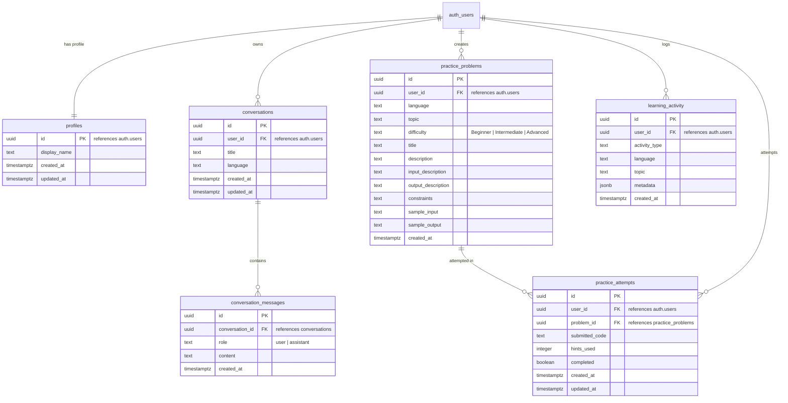

# CodeBuddy AI — Database Schema & Security Specification

CodeBuddy AI uses PostgreSQL hosted on Supabase, leveraging **Row Level Security (RLS)**, foreign keys with cascading deletes, indexing on query paths, and automated timestamp triggers.

---

## 1. Schema Diagram (ERD)

---

## 2. Row Level Security (RLS) Strategy

Row Level Security is enabled on **every** user-facing table. Supabase passes the authenticated JWT's subject claim as `auth.uid()`.

### Policies Summary:
1. **`profiles`**:
   - `SELECT`: `auth.uid() = id`
   - `INSERT`: `auth.uid() = id`
   - `UPDATE`: `auth.uid() = id`
2. **`conversations`**:
   - `ALL`: `auth.uid() = user_id`
3. **`conversation_messages`**:
   - Parent-child check:
     `EXISTS (SELECT 1 FROM conversations WHERE conversations.id = conversation_messages.conversation_id AND conversations.user_id = auth.uid())`
4. **`practice_problems`**:
   - `ALL`: `auth.uid() = user_id`
5. **`practice_attempts`**:
   - `ALL`: `auth.uid() = user_id`
6. **`learning_activity`**:
   - `ALL`: `auth.uid() = user_id`

This prevents Horizontal Privilege Escalation (IDOR) attacks: even if an attacker guesses a valid UUID belonging to another student, PostgreSQL rejects the query at the database engine level.
